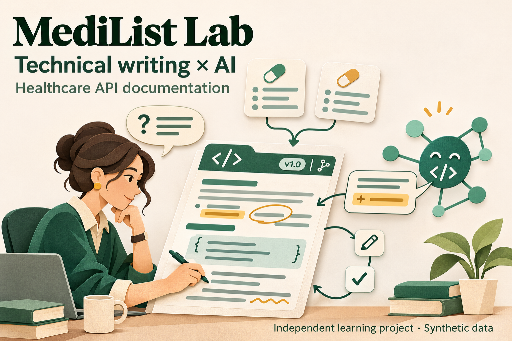

# LinkedIn draft — ongoing learning project

I’m learning API documentation, and I wanted a project closer to my work in healthcare.

Working with Codex, I’ve put together MediList Lab — a fictional medication-list API. AI helped with the demo, docs and tests; I’m learning by questioning its suggestions, checking the examples and making the writing my own.

It’s an ongoing, independent learning project using synthetic data.

[Explore MediList Lab](https://fabianbrue.github.io/medilist-lab-api-docs/)

How are you learning to work with AI?

#APIDocumentation #HealthcareIT #HumanAIcollaboration

---

## Image to attach

[Download the LinkedIn image](assets/medilist-lab-linkedin.png). Attach it separately when publishing the post.

Image generated with ImageGen for this independent learning project.
